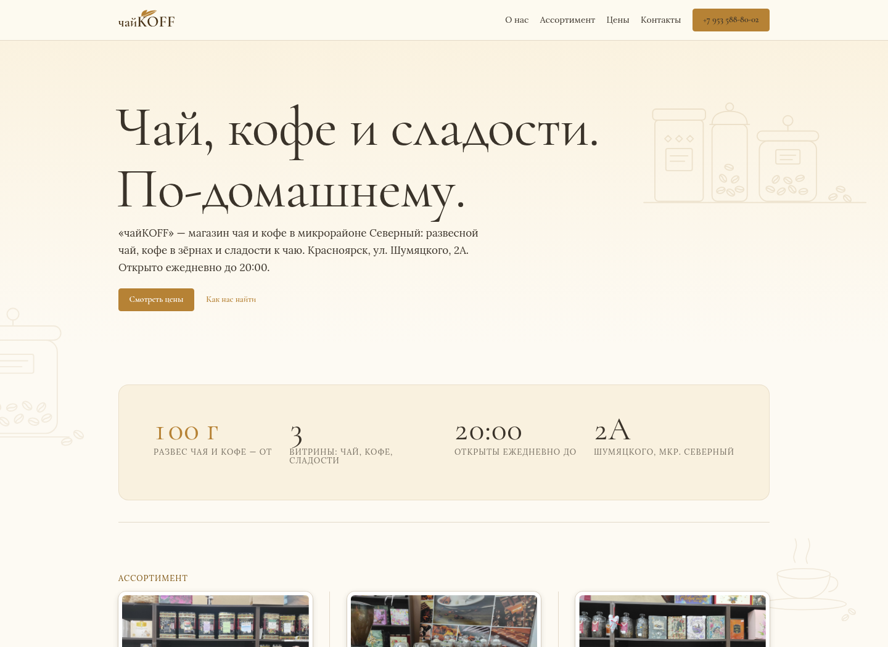
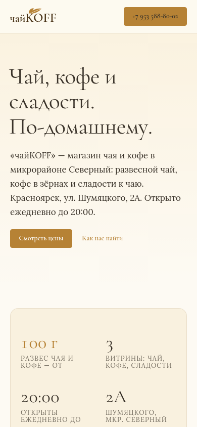

<div align="center">
  <h1>чайKOFF</h1>
  <p><strong>Чай, кофе и сладости. По-домашнему.</strong></p>
  <p>Одностраничный сайт магазина в Красноярске: ассортимент, цены, фотографии и контакты.</p>
  <p><strong>HTML · CSS · JavaScript</strong> &nbsp; / &nbsp; Без сборки &nbsp; / &nbsp; Адаптивная вёрстка</p>
  <p>
    <a href="#скриншоты">Скриншоты</a> ·
    <a href="#локальный-запуск">Локальный запуск</a> ·
    <a href="#настройка-контента">Настройка контента</a>
  </p>
</div>

## Скриншоты

### Главная страница · Desktop

Первый экран с навигацией, описанием магазина и кнопками перехода к ценам и контактам. Размер окна — 1440 × 1050.



### Ассортимент

Три витрины: развесной чай, кофе в зёрнах и сладости.


### Мобильная версия

Первый экран при ширине 390 px.



Скриншоты сделаны с локально запущенного сайта. Цены, отзывы и часть фотографий пока остаются шаблонными.

## О проекте

Сайт магазина «чайKOFF» в микрорайоне Северный: Красноярск, ул. Шумяцкого, 2А. Тёплая светлая палитра, крупная типографика и фотографии витрин помогают познакомиться с ассортиментом перед визитом.

- Ассортимент чая, кофе и сладостей с фотографиями и описаниями.
- Отдельные блоки товаров и цен, галереи и отзывов.
- Адрес, режим работы, звонок по телефону, ссылки на WhatsApp и ВКонтакте.
- Адаптивная вёрстка для компьютеров и телефонов.
- Локальная дизайн-система и компонент `image-slot` для фотографий.

## Локальный запуск

Для основного варианта достаточно **Python 3**. Из корня проекта выполните:

```bash
python3 -m http.server 8080 --bind 127.0.0.1
```

Откройте [http://localhost:8080](http://localhost:8080). Для остановки сервера нажмите `Ctrl+C`.

Если установлен Node.js с npm, доступны команды:

```bash
npm start           # тот же HTTP-сервер; требуется Python 3
npm run start:node  # сервер serve через npx; требуется Node.js
```

Установка зависимостей и сборка для запуска не нужны. При первом вызове `start:node` npx может предложить скачать `serve`.

Используйте HTTP-сервер: открытие `index.html` через `file://` может мешать загрузке ресурсов и работе компонентов.

## Структура проекта

```text
.
├── index.html          # Разметка страницы, стили и содержимое
├── ds-base.js          # Загрузчик локальной дизайн-системы
├── image-slot.js       # Компонент слотов для фотографий
├── _ds/                # Стили, токены и скрипты дизайн-системы
├── Images/             # Логотип и фотографии чая, кофе и сладостей
├── assets/             # Дополнительные изображения
├── docs/screenshots/   # Скриншоты для README
└── package.json        # Команды локального запуска
```

## Настройка контента

Основное содержимое редактируется в `index.html`:

| Что изменить | Где искать |
| --- | --- |
| Заголовок и описание магазина | `.hero` |
| Фото и описания ассортимента | `#assort` |
| Названия товаров и цены | `#prices` |
| Фотографии магазина | `#gallery` |
| Отзывы | `#reviews` |
| Адрес, часы работы и ссылки | `#contacts` |

Для постоянной замены фотографии добавьте файл в `Images/` и укажите его путь в атрибуте `src` нужного `<image-slot>`. Компонент также поддерживает перетаскивание изображения прямо на слот для локального предпросмотра.

## Перед публикацией

- [ ] Заменить шаблонные названия товаров и цены «000 ₽» на актуальные.
- [ ] Добавить реальные отзывы вместо заглушек.
- [ ] Заполнить пустые слоты галереи: «Фото 2», «Фото 4» и «Фото 5».
- [ ] Проверить адрес, режим работы, телефон и ссылки на соцсети.
- [ ] Проверить переход «О нас»: секция `#about` сейчас закомментирована в `index.html`.

Для размещения подойдёт статический HTTP-хостинг. Загрузите `index.html`, оба JavaScript-файла и каталоги `_ds/`, `Images/`, `assets/`, сохранив их относительные пути. Серверная часть и база данных не требуются.
