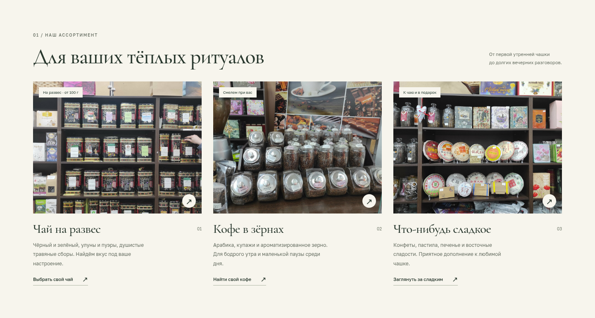

<div align="center">
  <h1>чайKOFF</h1>
  <p><strong>Чай, кофе и сладости. По-домашнему.</strong></p>
  <p>Сайт магазина в Красноярске: ассортимент, знакомство с лавкой и контакты.</p>
  <p>HTML · CSS · JavaScript · Без сборки</p>
</div>

## Скриншоты





## О проекте

Сайт магазина «чайKOFF» в микрорайоне Северный: Красноярск, ул. Шумяцкого, 2А. Сливочный фон, глубокий зелёный и фотографии настоящих витрин. Шрифты Cormorant Garamond и Golos Text загружаются с Google Fonts; предусмотрены резервные шрифты.

- Чай, кофе и сладости: фотографии и описания ассортимента.
- Раздел о магазине и помощь в выборе подарка.
- Запрос наличия и цен через WhatsApp с готовым сообщением для каждой категории.
- Адрес, телефон, соцсети, карта и построение маршрута.
- Мобильное меню с поддержкой клавиатуры и закрытием по Escape.
- Адаптивная вёрстка, видимый фокус и поддержка уменьшенного движения.

Шаблонные цены и отзывы убраны. Актуальную стоимость покупатель может уточнить у магазина.

## Локальный запуск

Требуется Python 3. Из корня проекта:

```bash
npm start
```

Или без Node.js:

```bash
python3 -m http.server 8080 --bind 127.0.0.1
```

Откройте [http://localhost:8080](http://localhost:8080). Остановка — `Ctrl+C`. Установка зависимостей и сборка не нужны.

## Структура

```text
.
├── index.html          # Содержимое страницы
├── styles.css          # Палитра, типографика, компоненты и адаптивная вёрстка
├── site.js             # Управление мобильным меню
├── Images/             # Фотографии магазина и исходный логотип
├── docs/screenshots/   # Скриншоты для README
└── package.json        # Команды локального запуска
```

Исходные `ds-base.js`, `image-slot.js`, `_ds/` и `assets/` сохранены в репозитории; текущая страница использует собственные стили и обычные изображения.

## Настройка контента

Основное содержимое находится в `index.html`:

| Что изменить | Где искать |
| --- | --- |
| Главный экран | `.hero` |
| Фото и описания ассортимента | `#assort` |
| Рассказ о магазине | `#about` |
| Категории и ссылки для запроса цен | `#prices` |
| Адрес, часы, телефон, соцсети и карта | `#contacts` |

Для замены фотографии добавьте файл в `Images/` и измените `src` соответствующего ``. Укажите содержательное описание в `alt`. Палитра и шрифты задаются переменными в начале `styles.css`.

Перед публикацией проверьте актуальность ассортимента, адреса, телефона, часов работы и внешних ссылок.

Для размещения подойдёт статический HTTP-хостинг. Загрузите `index.html`, `styles.css`, `site.js`, `favicon.svg` и каталог `Images/`, сохранив относительные пути. Серверная часть и база данных не требуются.
